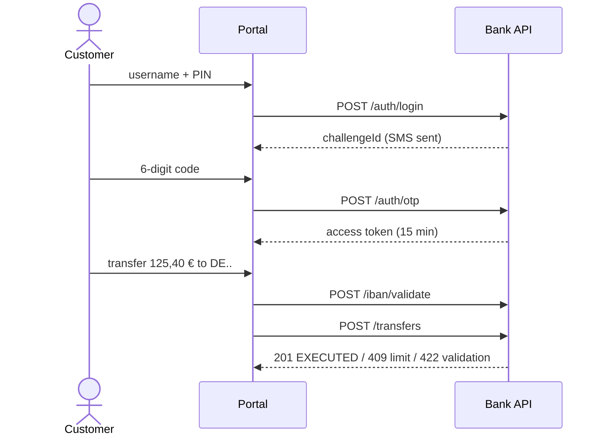

# Playwright Banking Portal

[](https://github.com/mukeshn/playwright-banking-portal/actions/workflows/playwright.yml)
[](https://mukeshn.github.io/playwright-banking-portal/)


[](LICENSE)

Test automation for a retail online-banking portal. It covers two-factor login, SEPA transfers with IBAN validation and daily limits, statements, the loan calculator, the idle-session timeout and the OAuth2 partner API.

> **📊 [Latest HTML report →](https://mukeshn.github.io/playwright-banking-portal/)**

## Scenarios

| Feature | What is verified |
|---|---|
| 🔐 Login + OTP | password step, masked phone, 3-attempt OTP lockout, blocked customers, protected routes |
| 💸 SEPA transfer | review/confirm step, IBAN normalisation + BLZ lookup, mod-97 checksum, insufficient funds, **daily limit across transfers**, scheduled payments |
| 📄 Statements | CSV download parsed and summed, printable statement in a **new tab** |
| ⏱️ Session timeout | warning at 4:00, logout at 5:00, activity resets the timer, all driven by `page.clock` in milliseconds |
| 🧮 Loan calculator | data-driven against an independent annuity formula |
| 🔌 Partner API | OAuth2 client credentials, Basic auth, scope enforcement, per-customer session isolation |

## Techniques worth a look

<details open>
<summary><b>Skipping the UI login without losing realism</b></summary>

The portal keeps its token in `sessionStorage`, which `storageState()` doesn't capture. The `authenticated` fixture logs in through the API and injects the token with `addInitScript`, but leaves the login page alone so logout and timeout flows still behave normally.

```ts
authenticated: async ({ page, bankApi }, use) => {
  const session = await bankApi.login(CUSTOMERS.julia);
  await page.addInitScript(({ token, name }) => {
    if (location.pathname.endsWith('/login.html')) return;
    sessionStorage.setItem('nb.token', token);
    sessionStorage.setItem('nb.name', name);
  }, { token: session.accessToken, name: session.customer.name });
  await use({ token: session.accessToken, name: session.customer.name });
},
```
</details>

<details>
<summary><b>Five minutes of inactivity in under a second</b></summary>

```ts
await page.clock.install();
await dashboard.goto();
await page.clock.fastForward('05:01');
await expect(page).toHaveURL(/login\.html\?reason=timeout/);
```
</details>

<details>
<summary><b>Generated, always-valid IBANs</b></summary>

`src/utils/iban.ts` computes the ISO 13616 check digits, so every transfer test uses a fresh beneficiary. `corrupt()` flips a digit for the negative cases.

```ts
germanIban('37040044', '0532013000'); // DE89370400440532013000
corrupt(randomGermanIban());          // guaranteed checksum failure
```
</details>

## Flow under test



## Run it

```bash
npm ci
npx playwright test                 # UI + API projects, SUT starts automatically
npx playwright test --project=api   # API only, ~2s
npx playwright test --grep @security
```

<details>
<summary><b>Test data</b></summary>

| Username | Password | Notes |
|---|---|---|
| `j.schneider` | `Demo#2026` | main persona |
| `m.weber` | `Demo#2026` | second persona for isolation tests |
| `blocked.user` | `Demo#2026` | online banking blocked |

The OTP comes from a sandbox endpoint (`/api/bank/__test/otp`), which is the mock's stand-in for a bank's test SMS gateway. Each login gets its own copy of the account data, so parallel workers never fight over balances.
</details>

---
Related: [rest-assured-banking-api](https://github.com/mukeshn/rest-assured-banking-api) · [selenium-cucumber-banking-bdd](https://github.com/mukeshn/selenium-cucumber-banking-bdd)
